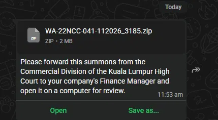

On 4 November 2026, a WhatsApp message impersonating the **Commercial Division of the Kuala Lumpur High Court** delivered a ZIP named `WA-22NCC-041-112026_3185.zip`. It told the recipient to forward the "summons" to the company's **Finance Manager** and to open it on a computer.

Inside is an ISO. A Microsoft-signed Office executable disguised as a PDF loads a malicious DLL, which pulls shellcode out of the pixels of a bitmap and tries to call home to `101[.]33[.]117[.]120` on TCP port 778.

> Scope note: this is static analysis of the delivered files plus one process memory dump from a test machine. TLP:CLEAR, and every IP is defanged. The second-stage payload was not captured, so the full capabilities are unknown.

## Key findings

- The lure is localized to Malaysia and aimed at finance staff. That points to a financial-crime motive, but this is an assessment: the message itself states no goal.
- The malware stacks three evasion layers: a trusted signed host program, a payload hidden in an image, and execution entirely in memory.
- The ZIP contents were verified byte-identical to the ISO analyzed. The memory dump confirmed that the extracted shellcode ran and made repeated connection attempts to the C2.
- Likely family: ValleyRAT / Winos 4.0, at moderate confidence.

**Do now:** block the C2 IP and port, search for the hashes in the IOC section, find out who received or opened the ZIP, and isolate any machine that ran the ISO.

## Delivery and social engineering

The WhatsApp message read:

> Please forward this summons from the Commercial Division of the Kuala Lumpur High Court to your company's Finance Manager and open it on a computer for review.



| Element | Why it works |
|---|---|
| Court summons | Creates fear and urgency, so recipients act before verifying |
| Finance Manager as the end target | Finance staff typically control payments and banking access |
| "Forward this" | Spreads the file to more people inside the organization |
| "Open it on a computer" | An ISO cannot be mounted on a phone, so the victim is steered to Windows |
| Case-style filename `WA-22NCC-041-112026` | Looks like a court reference with a month and year, but is not verifiable |
| WhatsApp as the channel | No attachment scanning like a managed email gateway |

The `_3185` suffix on the ZIP name may be a per-victim or per-batch tag. No other samples were reviewed.

## Attack chain

```text
WhatsApp message (fake court summons)
  -> ZIP attachment
  -> ISO image (auto-mounts as a drive)
  -> User runs "NA.pdf 1.EXE" (genuine Microsoft-signed program)
  -> Windows loads attacker's msvcr100.dll from the same folder (DLL sideloading)
  -> DLL reads the red value of every pixel in CoreUI_sys.ax (a BMP image)
  -> Base64 decode -> 2,381 bytes of x86 shellcode + config
  -> VirtualAlloc (read-write-execute) -> copy -> jump to shellcode
  -> Shellcode connects to 101[.]33[.]117[.]120:778
  -> Next stage received, XOR-decoded (0xCC), executed (NOT captured)
```

### Container and files

The ZIP holds one file, `WA-22NCC-041-112026.img` (10.5 MB, ISO 9660, volume label `2026_11_04`). The ISO contains:

| File | Size | Actual nature |
|---|---|---|
| `NA.pdf 1.EXE` | 86 KB | Genuine Microsoft Office 2013 `NameControlServer.exe` (signed), used as a trusted launcher |
| `msvcr100.dll` | 10.4 MB | Malicious loader (a genuine copy is under 1 MB) |
| `CoreUI_sys.ax` | 15 KB | A 61x61 pixel BMP carrying the encoded payload |

### DLL sideloading

The signed executable imports `MSVCR100.dll`. Windows searches the program's own folder first, so it loads the attacker's copy. The malicious DLL:

- exports 16,384 functions (half with random-suffixed names) to resemble a runtime library;
- has a `DllMain` that does nothing, while every export runs the same loader routine;
- was compiled on 2026-11-03 21:06 UTC (timestamps can be forged) and carries a bogus PDB name, `fdpcdsf23j71x.pdb`.

### Payload hidden in an image

The loader starts GDI+, opens `CoreUI_sys.ax`, and reads each pixel with `GdipBitmapGetPixel`. It keeps only the red value of each pixel and skips zeros, which yields about 3,176 base64 characters. The blue and green channels are random noise that makes the image look natural. No payload exists on disk in a recognizable form.

### In-memory execution

The base64 decodes to 2,381 bytes of x86 shellcode, followed by the marker `codemark` and a configuration block. The loader calls `VirtualAlloc` with execute permission, copies the shellcode in, and jumps to it. It runs in the same process: no new process or thread, and no file written.

### Shellcode behavior

- Resolves Windows API addresses by hashing export names (BKDR hash, multiplier 131). Every hash resolved to a common memory or networking API: `LoadLibraryA`, `VirtualAlloc`, `WSAStartup`, `socket`, `getaddrinfo`, `htons`, `connect`, `send`, `recv`, `closesocket`, `WSACleanup`.
- Connects to the C2 over TCP. The code also contains a UDP path.
- Allocates executable memory, receives data into it, XOR-decodes it with `0xCC`, and executes it.

### Configuration

The configuration is a reversed `|key:value|` string appended to the shellcode.

| Key | Decoded value | Interpretation |
|---|---|---|
| `p1`, `p2` | `101.33.117.120` | C2 address (primary and backup) |
| `o1`, `o2` | `778` | C2 port |
| `t1`, `t2` | `1` | Transport flag |
| `p3`, `o3` | `127.0.0.1`, `80` | Unused placeholder slot |
| `bz` | `2026.11. 4` | Version or build date |
| `bb` | `1.0` | Version |
| `db`, `lk`, `hs`, `ld`, `ll`, `hb`, `pj`, `lc`, `dd` | `0` or `1` | Flags or timers; meanings not confirmed |

The format and the `codemark` marker match the ValleyRAT configuration described in [Zscaler ThreatLabz research](https://www.zscaler.com/blogs/security-research/technical-analysis-latest-variant-valleyrat).

## Dynamic evidence from the memory dump

A process dump from a Windows 10 (x86) test machine, captured at 10:32 UTC, confirmed the static findings.

| Observation | Significance |
|---|---|
| Process `E:\NA.pdf 1.EXE` with `E:\msvcr100.dll` loaded | The sideload succeeded from the mounted ISO |
| GDI+ and Windows Imaging components loaded | Consistent with the loader reading the bitmap |
| RWX page at `0xd80000`, byte-identical to the extracted shellcode | Confirms the decoded shellcode executed |
| `ws2_32.dll` and `mswsock.dll` loaded | Network activity began |
| 18 socket-address structures for `101.33.117.120:778`, some with different local ports | Repeated connection attempts; the server may not have responded |
| No large executable region or injected PE | The second stage had not been received |

## MITRE ATT&CK mapping

| Tactic | Technique | Evidence |
|---|---|---|
| Initial Access | T1566 Phishing (via messaging) | WhatsApp lure |
| Execution | T1204.002 User execution: malicious file | User runs the fake PDF |
| Defense Evasion | T1036.007 Double file extension | `NA.pdf 1.EXE` |
| Defense Evasion | T1553.005 Mark-of-the-Web bypass | ISO container (typical purpose; not tested) |
| Defense Evasion | T1574.002 DLL side-loading | Rogue `msvcr100.dll` |
| Defense Evasion | T1027.003 Steganography | Payload in BMP pixels |
| Defense Evasion | T1027.007 Dynamic API resolution | Hashed API lookup |
| Defense Evasion | T1620 Reflective code loading | Shellcode run from memory |
| Defense Evasion | T1140 Deobfuscate/decode files | Base64 and XOR 0xCC |
| Command and Control | T1095 Non-application layer protocol | Raw TCP to port 778 |

## Assessment and confidence

| Assessment | Confidence |
|---|---|
| The ZIP, ISO and DLL are malicious | High |
| The shellcode attempts to contact `101.33.117.120:778` | High (static code, config and memory dump agree) |
| The campaign targets Malaysian finance staff | Moderate (lure content only; no victim data seen) |
| The malware belongs to the ValleyRAT / Winos 4.0 family | Moderate (config format and marker match; the BMP steganography and `0xCC` XOR are not in the public report I compared) |
| The goal is financial theft or remote access | Low (inferred from the lure; second stage unseen) |

**Limitations**

- How the message reached its recipients, and how many received it, is unknown.
- Whether the C2 answered is unknown; the dump shows attempts only.
- The second stage was not captured, so persistence, data theft and other capabilities are unconfirmed.
- Analysis was static plus one memory dump; no live sandbox or network capture was available.

## What to do about it

**Immediate**

1. Block `101[.]33[.]117[.]120` (all ports, at minimum TCP 778) at the firewall and proxy.
2. Search endpoint and email/chat telemetry for the file hashes below.
3. Ask finance and legal staff whether they received, forwarded or opened `WA-22NCC-041-112026_3185.zip`.
4. If anyone ran the ISO: isolate the machine, review outbound connections since about 11:53 (Malaysia time) on 4 November, and treat credentials used on it as exposed until cleared.

**This week**

5. Tell staff that courts do not serve summons through WhatsApp, and that no document should be forwarded or opened because a message says so.
6. Report the sender's WhatsApp account in the app and report the incident to MyCERT (Cyber999).
7. Hunt for the behaviors in the next section.

**Longer term**

8. Block automatic ISO/IMG mounting for standard users, or require approval.
9. Restrict execution from removable and mounted drives, and restrict DLL loading from non-system paths (application control).
10. Add finance-team phishing training that includes messaging-app lures.

## Detection and hunting guidance

- A process loading `msvcr100.dll` from a path outside `System32` or `SysWOW64`, especially a mounted drive.
- An executable started from a drive created by mounting an `.iso` or `.img` file.
- `NameControlServer.exe`, or any file named `NA.pdf 1.EXE`, running outside Office installation folders.
- A process opening a small `.ax` or `.bmp` file followed shortly by `VirtualAlloc` with execute permission.
- GDI+ loaded by a process with no user interface.
- Outbound connections to `101[.]33[.]117[.]120`, or traffic on TCP/UDP 778 from an Office-signed binary.
- Memory scanning for the marker `codemark` followed by the C2 address.

## Indicators of compromise

IP addresses are defanged with `[.]`.

**Network**

| Indicator | Context |
|---|---|
| `101[.]33[.]117[.]120:778` | C2 (TCP; UDP path also present) |

**Files**

| Name | SHA-256 |
|---|---|
| `WA-22NCC-041-112026_3185.zip` | `77c21d7c23e96d2103d4c41d5911e83d38ae2e5ba520e44e16183bdf3f970211` |
| `WA-22NCC-041-112026.img` | `2ff01c64f5f5cb076659d82865513a7fa632c02e7721a05d21c889090d559d21` |
| `msvcr100.dll` (malicious) | `3157305efe2849745c0fa5167754a234fc48759af1b084bb29e2fa97563ff4c1` |
| `CoreUI_sys.ax` | `2d28d846ba7f31b97e2a20cbac1d0183ecbc4e41e9fae4c33b1fc66ddccac983` |
| Decoded shellcode | `3fc133be6b6419faa5c47c2c6b8e037cf5712d48545199d1e662300a5280b03a` |
| `NA.pdf 1.EXE` (legitimate Microsoft binary; context only, do not block) | `676d2ebe22f7545f100ce151e47b1b1359455bb3bc42e18e61018a6d01c35293` |

**Other**

| Indicator | Value |
|---|---|
| ZIP MD5 | `75d98dc9e2ead5c907cd7487e7bda971` |
| DLL MD5 | `7e42acad053d216aeaad7798756d3f1e` |
| DLL imphash | `937f6d94267ff5321d3c1b6aec65a8fa` |
| DLL PDB string | `fdpcdsf23j71x.pdb` |
| ISO volume label | `2026_11_04` |
| Memory marker | `codemark` followed by `101.33.117.120` |
| Delivery channel | WhatsApp, 2026-11-04, about 11:53 Malaysia time |

## Sources

- Zscaler ThreatLabz, [Technical analysis of the latest variant of ValleyRAT](https://www.zscaler.com/blogs/security-research/technical-analysis-latest-variant-valleyrat)
